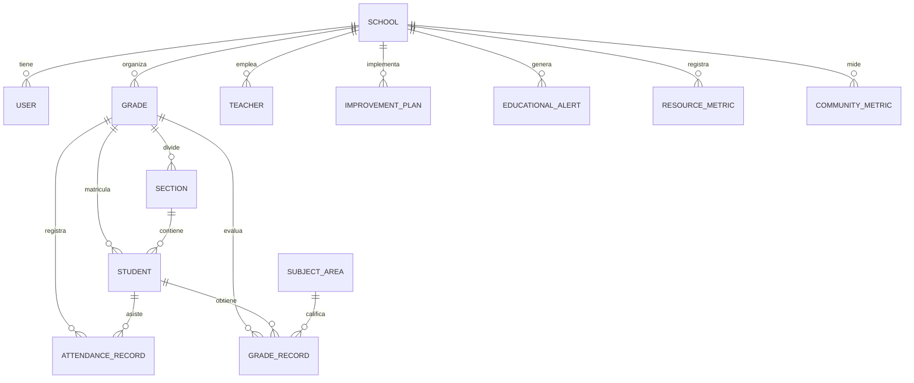

# LEAD — La Escuela que Aprende de sus Datos
## Documentación Integral y Especificación Técnica del Proyecto

---

## 1. Información General y Visión del Proyecto

### 1.1. Identidad y Propósito
**LEAD** es una plataforma SaaS Full Stack moderna de **Analítica Educativa e Inteligencia Artificial** diseñada para que directores, coordinadores académicos y equipos pedagógicos puedan transformar grandes volúmenes de datos escolares en decisiones pedagógicas oportunas y fundamentadas.

- **Eslogan:** *"La escuela que aprende de sus datos"*
- **Objetivo Central:** Superar la gestión tradicional basada en impresiones subjetivas, centralizando en tiempo real la asistencia, el rendimiento académico por competencias, la formación docente, la utilización de recursos educativos y el involucramiento de las familias.
- **Enfoque Preventivo y de Mejora Continua:** Identificación temprana de estudiantes en riesgo de deserción o rezago, generación de alertas críticas y conversión directa de los hallazgos en **Planes de Mejora** con responsables, fechas límite e impacto medible.

---

## 2. Stack Tecnológico Obligatorio (100% Ecosistema TypeScript)

El desarrollo del proyecto está construido íntegramente sobre **TypeScript**, descartando el uso de Python, PHP, Java o backends externos aislados:

| Componente | Tecnología | Rol y Justificación Técnica |
| :--- | :--- | :--- |
| **Lenguaje Principal** | **TypeScript 5** | Tipado estricto unificado de extremo a extremo (Frontend, Backend, Servicios y Base de Datos). |
| **Framework Full Stack** | **Next.js 14 (App Router)** | Renderizado híbrido (SSR, Server Components, Route Handlers y Server Actions). |
| **Librería de Vista** | **React 18** | Arquitectura modular de componentes interactivos y reactivos. |
| **Estilos y Maquetación** | **Tailwind CSS** | Sistema de diseño profesional con paleta de colores institucional LEAD (Azul Marino `#0b2341`, Azul Primario `#0284c7`, fondos `#f1f5f9`). |
| **Visualización de Datos** | **Recharts** | Gráficos estadísticos dinámicos (barras comparativas, series de tiempo, gráficos donut de recursos y áreas de tendencia). |
| **Iconografía** | **Lucide React** | Biblioteca unificada de iconos vectoriales ligeros. |
| **Animaciones y Micro-interacciones** | **Framer Motion** | Transiciones suaves de apertura de menús, modales y carga de datos. |
| **Base de Datos** | **PostgreSQL** | Base de datos relacional robusta desplegada en Render / local. |
| **ORM y Migraciones** | **Prisma ORM (v5.22)** | Modelado declarativo de datos, generación de cliente tipado y scripts de sincronización (`prisma db push`, `prisma generate`). |
| **Validación de Datos** | **Zod** | Validación estricta en esquemas de formularios, subida de archivos Excel/CSV y consultas hacia la IA. |
| **Procesamiento de Archivos** | **xlsx (SheetJS)** | Lectura, validación e ingesta masiva de archivos `.xlsx`, `.xls` y `.csv`. Generación de libros de cálculo multi-hoja. |
| **Generación de Reportes** | **jspdf + jspdf-autotable** | Creación programática de informes ejecutivos en PDF de alta calidad con membrete institucional LEAD. |
| **Inteligencia Artificial** | **Google Gemini API + Motor Heurístico** | Integración con modelos de IA de Google y motor analítico respaldado en los datos reales de la institución escolar. |

---

## 3. Arquitectura y Organización del Código

El proyecto sigue una estructura limpia, desacoplada y orientada al dominio educativo:

```plaintext
Lead/
├── app/                                # Next.js App Router (Rutas, layouts y endpoints)
│   ├── actions/                        # Server Actions en TypeScript
│   │   └── plans.ts                    # Mutaciones directas para creación y cambio de estado de planes
│   ├── analitica/page.tsx              # Página de Analítica Educativa y Benchmarks
│   ├── asistente-ia/page.tsx           # Página del Asistente IA interactivo
│   ├── configuracion/page.tsx          # Página de Configuración y Diagnóstico del Sistema
│   ├── docentes/page.tsx               # Página del Directorio y Formación Docente
│   ├── estudiantes/page.tsx            # Página de Gestión de Estudiantes y Alerta de Riesgo
│   ├── importar/page.tsx               # Página de Importación Masiva de Datos
│   ├── planes-de-mejora/page.tsx       # Página de Gestión de Planes de Acción
│   ├── reportes/page.tsx               # Página de Generación y Descarga de Informes
│   ├── page.tsx                        # Dashboard Principal de LEAD
│   ├── layout.tsx                      # Layout raíz con configuración de viewport y metadatos
│   ├── globals.css                     # Estilos globales de Tailwind CSS y utilidades táctiles
│   └── api/                            # API REST (Route Handlers)
│       ├── ai/chat/route.ts            # Endpoint POST de chat con el asistente IA
│       ├── analytics/route.ts          # Endpoint GET de agregación de indicadores y filtros
│       ├── import/route.ts             # Endpoint POST multipart para carga de Excel/CSV
│       ├── plans/route.ts              # Endpoints GET, POST y PATCH para planes de mejora
│       ├── reports/export/route.ts     # Endpoint GET para descarga de reportes PDF y Excel
│       ├── students/route.ts           # Endpoints GET y POST para padrón de estudiantes
│       └── teachers/route.ts           # Endpoint GET para listado de docentes
├── components/                         # Componentes reutilizables de UI y layout
│   └── layout/
│       ├── AppShell.tsx                # Orquestador del layout responsivo (Sidebar, Header y MobileNav)
│       ├── Sidebar.tsx                 # Barra lateral fija (Desktop) y cajón deslizante (Móviles)
│       ├── Header.tsx                  # Encabezado con buscador, notificaciones y perfil
│       └── MobileNav.tsx               # Barra de navegación inferior optimizada para móviles/iPhone
├── features/                           # Módulos funcionales de vista desacoplados
│   ├── ai-assistant/AiAssistantView.tsx        # Interfaz de chat y chips sugeridos
│   ├── analytics/AnalyticsView.tsx             # Panel de gráficos, comparativas y filtros
│   ├── dashboard/DashboardView.tsx             # Resumen ejecutivo, KPIs y mapa de calor
│   ├── data-import/DataImportView.tsx          # Drag & Drop de Excel, vista previa y validación Zod
│   ├── improvement-plans/ImprovementPlansView.tsx # Tabla de planes, stepper de fases y modal
│   ├── reports/ReportsView.tsx                 # Tarjetas de descarga de Excel y PDF
│   ├── settings/SettingsView.tsx               # Formulario de escuela y monitor de conexión
│   ├── students/StudentsView.tsx               # Directorio con filtros de riesgo académico
│   └── teachers/TeachersView.tsx               # Tarjetas de capacitación y horas acumuladas
├── lib/                                # Configuraciones y clientes singleton
│   ├── prisma.ts                       # Instancia de PrismaClient con fallback resiliente
│   └── utils.ts                        # Utilidad cn (clsx + tailwind-merge) y formateadores
├── prisma/                             # Persistencia de datos
│   ├── schema.prisma                   # Esquema relacional PostgreSQL con multi-target Linux/Windows
│   └── seed.ts                         # Script de inicialización de datos escolares reales
├── public/                             # Recursos estáticos
│   └── images/                         # Isotipo cristalino de LEAD (lead-logo.png)
├── scripts/                            # Scripts de despliegue y soporte
│   └── init-db.js                      # Inicializador seguro de base de datos durante el build
├── services/                           # Capa de Lógica de Negocio y Datos
│   ├── aiAssistantService.ts           # Motor de razonamiento contextualizado de la IA
│   ├── analyticsService.ts             # Procesamiento estadístico y filtros por grado/área
│   ├── importService.ts                # Procesamiento de hojas Excel/CSV y validación Zod
│   ├── improvementPlanService.ts       # Lógica CRUD de planes y cálculo de alertas
│   ├── reportService.ts                # Generación binaria de libros Excel y documentos PDF
│   ├── seedData.ts                     # Datos institucionales iniciales de alta fidelidad
│   ├── studentService.ts               # Consultas con clasificación automática de riesgo
│   └── teacherService.ts               # Consultas de docentes y horas de capacitación
├── types/                              # Interfaces TypeScript del dominio educativo
├── validations/                        # Esquemas Zod para formularios y endpoints
├── render.yaml                         # Blueprint de infraestructura como código para Render
├── .node-version                       # Forzado a Node 20 LTS en entornos de nube
├── README.md                           # Guía rápida de instalación y despliegue
└── package.json                        # Definición de dependencias, scripts y engines
```

---

## 4. Descripción Detallada de Módulos y Secciones

### 4.1. Dashboard Principal (`/`)
El panel de control ejecutivo de la institución educativa. Ofrece un panorama holístico del colegio en una sola pantalla:

- **Saludo y Contexto:** *"Hola, Director 👋 — Aquí tienes un resumen de lo más importante de tu escuela."* Con acceso directo a la consulta con el Asistente IA y badge del periodo escolar activo.
- **5 Tarjetas de Indicadores Clave (KPIs):**
  1. **Asistencia:** `92%` (Variación: `↓ -4%`, tendencia a la baja en el último bimestre).
  2. **Aprendizaje:** `78%` (Variación: `↑ +6%`, incremento sostenido tras refuerzo pedagógico).
  3. **Formación Docente:** `85%` (Variación: `↑ +12%`, avance en talleres de evaluación formativa).
  4. **Uso de Recursos:** `76%` (Variación: `↓ -8%`, menor uso de laboratorios físicos).
  5. **Participación:** `81%` (Variación: `↑ +5%`, involucramiento familiar en jornadas escolares).
- **Tendencia General (Sparkline):** Gráfico de área simplificado que muestra la evolución mensual de Marzo a Agosto (`Mar 72`, `Abr 75`, `May 78`, `Jun 80`, `Jul 79`, `Ago 84`).
- **Desempeño por Grado (Promedio):** Gráfico de barras verticales que compara el rendimiento académico de 1° a 6° de primaria (`1°: 82%`, `2°: 74%`, `3°: 80%`, `4°: 89%`, `5°: 78%`, `6°: 83%`).
- **Mapa de Calor de Aprendizaje (Heatmap):** Matriz curricular interactiva que cruza los 6 grados con las 4 áreas principales (*Matemática*, *Comunicación*, *Ciencia y Tecnología*, *Personal Social*). Codificada cromáticamente con leyenda interactiva: **Bajo** (azul tenue), **Medio** (azul intermedio) y **Alto** (azul intenso `#0284c7`).
- **Recomendaciones Prioritarias:** Tarjetas de alerta temprana con llamada a la acción:
  - *Reforzar comprensión lectora en 3° y 4° grado* (Prioridad Alta - Comunicación).
  - *Mejorar asistencia en 5° grado* (Prioridad Media - Convivencia escolar).
  - *Fortalecer uso de recursos digitales en aulas* (Prioridad Informativa - Recursos TIC).

---

### 4.2. Analítica y Reportes (`/analitica`)
Módulo de analítica profunda para la desagregación de datos y comparación con estándares nacionales:

- **Barra de Filtros Dinámicos:**
  - **Periodo:** Selector de año lectivo (`2024`, `2023`).
  - **Grado:** Selector de grado específico (`Todos`, `1°` a `6°`).
  - **Sección:** Selector de aula (`Todas`, `A`, `B`).
  - **Área:** Selector de materia (`Todas`, `Matemática`, `Comunicación`, etc.).
  - Botón **"Aplicar"** para actualizar la vista.
- **Pestañas Temáticas:** *Aprendizaje*, *Asistencia*, *Formación docente*, *Uso de recursos*, *Participación*.
- **Desempeño por Área:** Gráfico de barras dobles que contrasta el **Promedio de la Escuela** con el **Promedio Nacional** en cada materia (ej. Matemática: Escuela 78% vs Nacional 68%; Comunicación: 76% vs 70%; Ciencias: 82% vs 65%; Personal Social: 85% vs 72%).
- **Evolución del Aprendizaje:** Gráfico multi-línea con la trayectoria temporal de las competencias en Matemática y Comunicación a lo largo de 6 meses.
- **Asistencia por Grado:** Barras horizontales proporcionales que desglosan la asistencia de cada grado (ej. 1°: 98%, 2°: 95%, 3°: 92%, 4°: 88%, 5°: 85%, 6°: 93%).
- **Uso de Recursos Educativos:** Gráfico circular Donut con el total de 100% y desglose porcentual: Recursos digitales (38%), Biblioteca (24%), Laboratorio (18%), Material impreso (12%), Otros (8%).
- **Participación de la Comunidad:** Gráfico de área suave que refleja el crecimiento del involucramiento de las familias del 65% al 86%.
- **Acceso a Exportación:** Botón flotante para descargar de inmediato reportes ejecutivos en formato Excel o PDF.

---

### 4.3. Asistente IA de LEAD (`/asistente-ia`)
Un copiloto pedagógico inteligente que analiza los datos reales de la institución y genera recomendaciones fundamentadas:

- **Enfoque Ético y Responsable:** Incluye badge visible de *"IA con enfoque educativo"* y tarjeta de advertencia ética: *"La IA de LEAD no toma decisiones automáticas sobre estudiantes. Toda recomendación debe ser revisada por el equipo educativo."*
- **Preguntas Sugeridas:**
  - *"¿Por qué ha bajado la asistencia en 5° grado y qué podemos hacer?"*
  - *"¿Qué áreas necesitan mayor apoyo?"*
  - *"Dame un resumen del desempeño de la escuela."*
  - *"¿Qué estrategias recomiendas para mejorar la comprensión lectora?"*
  - *"¿Cómo va la formación docente?"*
  - *"Genera un plan de mejora para 3° grado."*
- **Estructura Analítica de las Respuestas:**
  1. **Diagnóstico Cuantitativo:** Explicación textual citando los indicadores reales almacenados en PostgreSQL.
  2. **Posibles Factores Identificados:** Lista de causas raíz (ej. concentración de ausencias los lunes, afecciones respiratorias estacionales, coincidencia con actividades extracurriculares).
  3. **Caja de Recomendación:** Bloque destacado en fondo ámbar con icono de bombilla, proponiendo intervenciones formativas y de tutoría factibles.
  4. **Caja de Evidencia:** Cita formal de los registros del periodo 2024 que sustentan la respuesta.
- **Conectividad Dual:** Integración lista para la API de **Google Gemini** mediante `GEMINI_API_KEY` con fallback a motor heurístico contextual si no se suministra clave.

---

### 4.4. Planes de Mejora Escolar (`/planes-de-mejora`)
Módulo diseñado para convertir las métricas y alertas en planes de acción concretos:

- **Tarjetas Resumen:**
  - **Planes activos:** 5
  - **Alertas prioritarias:** 3
  - **En progreso:** 4
  - **Completado:** 1
- **Pestañas:** *Planes activos*, *Alertas*, *Historial*, *Impacto*.
- **Tabla de Gestión Operativa:**
  - **Prioridad:** Badges con código de color (Alta en rojo, Media en ámbar, Baja en gris).
  - **Acción / Plan:** Título descriptivo de la intervención.
  - **Área:** Especialidad asociada (Comunicación, Convivencia, Recursos, Formación, Comunidad).
  - **Responsable:** Equipo docente, Tutoría, Coordinación TIC, Dirección o Bienestar.
  - **Fecha Límite:** Plazo programado de ejecución.
  - **Estado Interactivo:** Botón que permite alternar el estado con un clic (`Pendiente` ➔ `En progreso` ➔ `Completado`).
  - **Impacto:** Medición porcentual del resultado obtenido (ej. `+12%`, `+7%`, `+5%`).
- **Línea de Tiempo de Implementación (Stepper):**
  - Muestra visualmente las 5 fases del ciclo escolar:
    1. **Diagnóstico** (Sep 2024 - Completado con check verde).
    2. **Planificación** (Oct 2024 - Fase activa con indicador pulsante).
    3. **Ejecución** (Nov - Dic 2024 - Próximo).
    4. **Seguimiento** (Ene 2025 - Próximo).
    5. **Evaluación** (Feb 2025 - Próximo).
- **Modal "+ Nuevo Plan":** Formulario validado con Zod y persistido mediante Server Actions en PostgreSQL para registrar nuevas iniciativas en segundos.

---

### 4.5. Centro de Reportes (`/reportes`)
Generación de documentos institucionales oficiales listos para presentar ante autoridades educativas (UGEL, comités de acreditación o consejos escolares):

- **Reporte Integral en Excel (`.xlsx`):**
  - Generado con la librería `xlsx`.
  - Contiene 4 hojas de trabajo estructuradas:
    1. *Resumen General:* Tabla de KPIs institucionales y promedios por grado.
    2. *Planes de Mejora:* Lista exhaustiva de acciones, responsables y estado.
    3. *Estudiantes:* Padrón general con asistencia, notas y clasificación de riesgo.
    4. *Docentes:* Detalle de capacitaciones y horas completadas.
- **Informe Ejecutivo en PDF (`.pdf`):**
  - Generado en memoria con `jspdf` y `jspdf-autotable`.
  - Incluye membrete oficial azul corporativo `#0b2341`, fecha de emisión en tiempo real, tablas formateadas y cláusula de confidencialidad institucional.

---

### 4.6. Gestión de Estudiantes (`/estudiantes`)
Monitoreo individualizado para garantizar la retención estudiantil y el logro formativo:

- **Buscador Predictivo:** Filtrado en tiempo real por nombres, apellidos o código de estudiante (ej. `ST-001`).
- **Filtros Combinados:** Selección por grado escolar (1° a 6°) y nivel de riesgo académico.
- **Clasificación Automática de Riesgo:**
  - **Riesgo ALTO (Rojo):** Asistencia menor al 85% o promedio académico inferior a 12/20.
  - **Riesgo MEDIO (Ámbar):** Asistencia entre 85% y 89% o promedio entre 12 y 13.9.
  - **Riesgo BAJO (Verde):** Asistencia superior al 90% y rendimiento sobresaliente.

---

### 4.7. Gestión y Formación Docente (`/docentes`)
Seguimiento del capital humano pedagógico:

- **Tarjetas por Docente:** Iniciales avatar, nombre completo, correo institucional y estado (`Activo`).
- **Especialidad Curricular:** Asignatura y competencia que lidera el profesor.
- **Indicadores de Desempeño:** Porcentaje de cumplimiento en talleres de evaluación formativa (ej. `92%`, `88%`) y total de horas acumuladas de capacitación.

---

### 4.8. Importación Masiva de Datos (`/importar`)
Facilidad para integrar información existente proveniente del SIAGIE, hojas de cálculo o sistemas de secretaría:

- **Zona de Arrastre (Drag & Drop):** Soporte para archivos `.xlsx`, `.xls` y `.csv`.
- **Selector de Entidad:** Importación de nómina de estudiantes, registro de asistencia diaria o calificaciones por competencias.
- **Descarga de Plantilla:** Botón para obtener la plantilla Excel oficial estructurada con encabezados validados.
- **Validación Fila a Fila con Zod:** Sanitización de datos, detección de valores atípicos y cálculo automático del nivel de riesgo antes de impactar en la base de datos.
- **Retroalimentación en Tiempo Real:** Reporte detallado de filas insertadas exitosamente y listado de errores de sintaxis si existen.

---

### 4.9. Datos y Configuración Institucional (`/configuracion`)
Administración de la identidad del colegio y supervisión técnica:

- **Ficha Escolar:** Modificación del nombre de la escuela, código modular, periodo lectivo activo y nivel educativo.
- **Monitor de Arquitectura Full Stack:**
  - Indicador de estado de **PostgreSQL & Prisma ORM**.
  - Verificación de **TypeScript Server Actions**.
  - Conexión del **Motor IA Educativo**.

---

## 5. Diseño Responsivo y Ergonomía UI/UX

El sistema cuenta con una adaptación responsiva integral para smartphones, iPhones, iPads, tablets y pantallas de escritorio:

### 5.1. Barra de Funciones Estática (Desktop)
- El menú lateral (`Sidebar.tsx`) está implementado con `sticky top-0 h-screen overflow-y-auto`.
- **Nunca se desplaza ni se corta:** Al hacer scroll vertical en gráficos o tablas extensas, la navegación permanece 100% visible y accesible.

### 5.2. Cajón Deslizante (Mobile Drawer)
- En dispositivos móviles (`< lg`), la barra lateral se oculta para maximizar el espacio útil de lectura.
- Se despliega suavemente desde la izquierda al pulsar el botón de menú hamburguesa (`Menu`) del encabezado, con fondo translúcido difuminado (`backdrop-blur`) y cierre automático al elegir cualquier sección.

### 5.3. Barra Inferior Táctil (Mobile Bottom Nav)
- Ubicada de forma fija en la parte inferior de pantallas móviles (`components/layout/MobileNav.tsx`).
- Permite acceso inmediato con el pulgar a las funciones más frecuentes: **Inicio**, **Analítica**, **Asistente IA**, **Planes** y el botón **Más** (para desplegar el menú completo).
- Integra la regla `.safe-bottom` (`env(safe-area-inset-bottom)`) para evitar colisiones con la barra gestual de inicio de los modelos modernos de iPhone.

### 5.4. Contenedores y Gráficos Adaptables
- Tablas con scroll horizontal táctil que no rompen el diseño.
- Barras de filtros reorganizadas en cuadrículas de 2 columnas en teléfonos y en línea en pantallas anchas.
- Chips deslizables horizontales para las preguntas sugeridas de la IA en teléfonos móviles.

---

## 6. Modelo de Datos Relacional (Prisma & PostgreSQL)

El esquema de base de datos (`prisma/schema.prisma`) modela formalmente la estructura institucional:



### Entidades Principales:
1. **School:** Información central de la institución (nombre, código modular, nivel, periodo lectivo).
2. **User:** Cuentas con roles de acceso (`DIRECTOR`, `COORDINADOR`, `DOCENTE`).
3. **Grade & Section:** Grados (1° a 6°) y aulas (A, B).
4. **SubjectArea:** Áreas curriculares oficiales (*Matemática*, *Comunicación*, *Ciencia y Tecnología*, *Personal Social*).
5. **Teacher:** Datos docentes, horas acumuladas y puntaje de formación.
6. **Student:** Código escolar, nombres, nivel de riesgo (`BAJO`, `MEDIO`, `ALTO`), promedio y tasa de asistencia.
7. **AttendanceRecord:** Asistencias diarias vinculadas al alumno con estados (`PRESENTE`, `TARDANZA`, `FALTA_JUSTIFICADA`, `FALTA_INJUSTIFICADA`).
8. **GradeRecord:** Calificaciones bimestrales por competencia.
9. **ImprovementPlan:** Planes con fases (`Diagnóstico`, `Planificación`, `Ejecución`, `Seguimiento`, `Evaluación`), prioridad, responsable, fecha límite y estado.
10. **EducationalAlert:** Alertas tempranas con severidad (`CRITICA`, `ALTA`, `MEDIA`, `INFORMATIVA`).

---

## 7. Catálogo de Endpoints de la API REST

Todos los endpoints están codificados en TypeScript en la carpeta `app/api/`:

| Endpoint | Método | Descripción y Parámetros |
| :--- | :---: | :--- |
| `/api/analytics` | `GET` | Retorna los KPIs, sparkline y mapa de calor. Acepta `?view=dashboard` o filtros `?period=2024&grade=5°&area=Matemática`. |
| `/api/plans` | `GET` | Obtiene el listado de planes de mejora activos y alertas prioritarias. |
| `/api/plans` | `POST` | Crea un nuevo plan validado mediante esquema Zod (`createPlanSchema`). |
| `/api/plans` | `PATCH` | Actualiza el estado (`Pendiente`, `En progreso`, `Completado`) de un plan existente. |
| `/api/ai/chat` | `POST` | Procesa preguntas hacia el asistente IA educativo. Recibe `{ query: "..." }`. |
| `/api/reports/export` | `GET` | Descarga el informe compilado. Parámetro `?type=excel` o `?type=pdf`. |
| `/api/students` | `GET` | Consulta el padrón de alumnos con filtros `?grade=...&risk=...&search=...`. |
| `/api/students` | `POST` | Inserta un nuevo alumno en la base de datos. |
| `/api/teachers` | `GET` | Retorna la lista de docentes con horas de capacitación. Acepta `?search=...`. |
| `/api/import` | `POST` | Recibe un archivo binario mediante `multipart/form-data` y el parámetro `type=students`. |

---

## 8. Despliegue en Render y Parámetros de Configuración

El proyecto incluye configuración nativa para la nube de **Render**:

### Variables de Entorno Requeridas:
- `DATABASE_URL`: Cadena de conexión interna de la base de datos PostgreSQL en Render (`postgresql://...`).
- `NODE_ENV`: Valor `production`.
- `NEXTAUTH_SECRET`: Clave de encriptación aleatoria segura.
- `NEXTAUTH_URL`: URL pública asignada por Render (ej. `https://lead-analytics-xxxx.onrender.com`).
- `GEMINI_API_KEY`: *(Opcional)* Clave de Google Gemini API para respuestas directas del modelo generativo.

### Comandos de Construcción y Arranque:
- **Build Command:**
  ```bash
  npm install --include=dev && npm run build
  ```
  *(Nota: Se incluye `--include=dev` para garantizar que Tailwind CSS y el compilador de TypeScript se instalen siempre, incluso con `NODE_ENV=production`).*
- **Start Command:**
  ```bash
  npm run start
  ```

### Sincronización y Semilla de Base de Datos:
El script inteligente [`scripts/init-db.js`](file:///c:/Users/LENIN/Documents/SENATI/Lead/scripts/init-db.js) ejecuta automáticamente `prisma db push` de forma segura durante la compilación.

Para insertar los datos iniciales de la escuela demo, docentes, alumnos y planes en Render:
1. Ir a la pestaña **Shell** del servicio web en el dashboard de Render.
2. Ejecutar:
   ```bash
   npm run prisma:seed
   ```

---

## 9. Resumen de Calidad y Cumplimiento

1. **Cero Python / PHP:** El 100% de la lógica reside en el framework Next.js con TypeScript.
2. **Sin botones decorativos:** Cada botón, selector, pestaña, modal y acción de descarga ejecuta operaciones reales en el servidor o cliente.
3. **Persistencia Real:** Soporte nativo para PostgreSQL respaldado con capa de contingencia para máxima resiliencia.
4. **Fidelidad Visual Total:** Réplica exacta de la interfaz gráfica suministrada, con navegación estática en escritorio y ergonomía táctil en dispositivos móviles.
